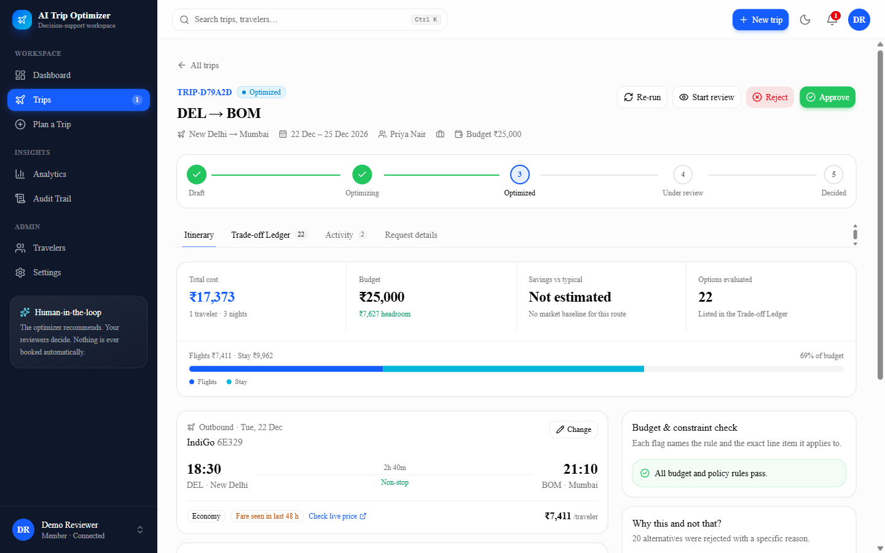
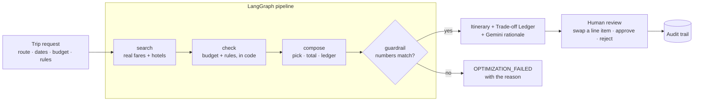
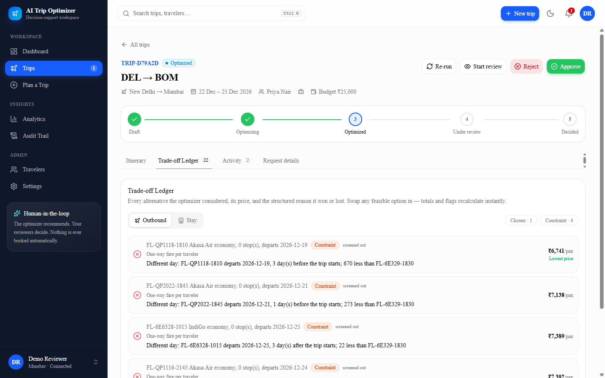
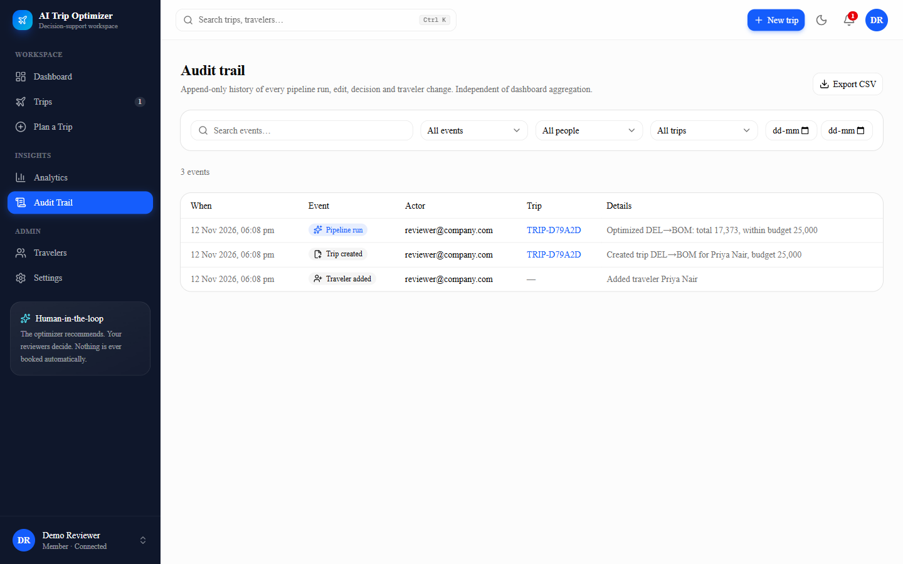
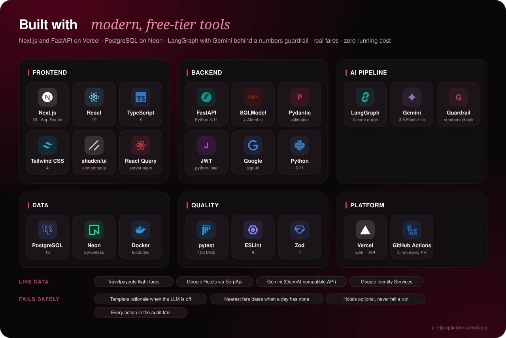
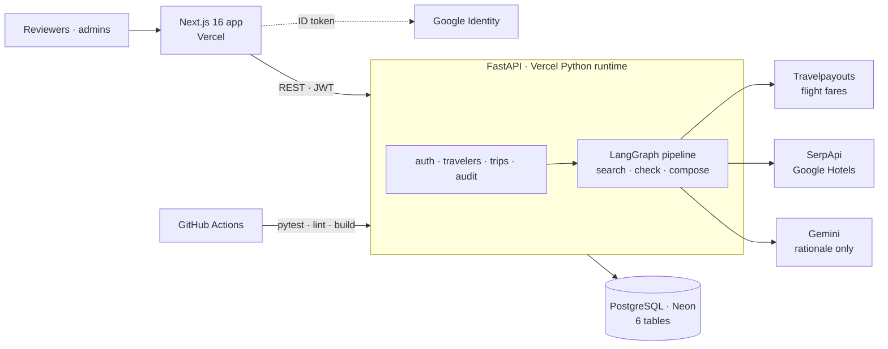

<div align="center">

# AI Trip Optimizer

### Explainable AI decision support for business travel

A team enters a trip request. A LangGraph pipeline searches **real flight fares and live hotel prices**, checks
every option against the budget and the traveler's rules, and composes an itinerary with a **Trade-off Ledger**
that says why each alternative won or lost. A human then edits, approves or rejects it. Nothing is ever booked
automatically, and every step lands in an **append-only audit trail**.

[](https://ai-trip-optimizer.vercel.app)
[](https://ai-trip-optimizer-api.vercel.app/docs)
[](.github/workflows/ci.yml)


**[Open the app](https://ai-trip-optimizer.vercel.app)** · [Why](#-why-ai-trip-optimizer) · [How it works](#-how-it-works) · [Architecture](#-architecture) · [Tech stack](#-tech-stack) · [Run locally](#-run-it-locally) · [Status](#-project-status) · [Docs](docs/)

<br />



</div>

<br />

## ✦ Why AI Trip Optimizer

Most "AI travel planners" hand you an answer and ask you to trust it. A business can't work that way: someone
has to approve the spend, and someone will later ask *why this flight and not the cheaper one?*

- **Every number is computed in code.** The LLM only writes the explanation, and a guardrail fails the run if it states a figure that isn't one of the computed ones.
- **Every alternative is accounted for.** The Trade-off Ledger lists each flight and hotel the pipeline saw, its price, and the specific reason it won or lost.
- **A human always decides.** The optimizer recommends; a reviewer edits, approves, or rejects with a reason.
- **Nothing is forgotten.** Every traveler change, optimizer run, edit and decision is written to an append-only audit trail in the same transaction as the action itself.

## ✦ At a glance

<div align="center">

| **8 / 8** | **17** | **153** | **6** | **11** | **~2.7 s** |
| :---: | :---: | :---: | :---: | :---: | :---: |
| PRD Must items live | API endpoints | backend tests | database tables | migrations | full optimizer run, live |

</div>

## ✦ How it works



| Step | What happens |
| :--- | :--- |
| **1. Request** | A traveler, IATA route (e.g. `DEL → BOM`), dates, budget and preferences such as `max_stops` or `min_hotel_rating`. The trip starts as `DRAFT`. |
| **2. Search** | Flight fares from **Travelpayouts** and hotel prices from **Google Hotels via SerpApi**. If the chosen day has no fare, the run fails and names the nearest dates that do. |
| **3. Check** | Pure Python: every option is tested against each rule. Each flag names the rule and the exact line item, e.g. *"Total 41,600 is 29,600 over the 12,000 budget"*. |
| **4. Compose** | The cheapest option meeting every rule wins. The total is computed in code. Every other option gets a ledger row: *"Price: 1,199 more than HT-c5ed804f"*, *"Different day: departs 2026-12-19, 3 day(s) before the trip starts"*. |
| **5. Explain** | Gemini writes a short rationale from those facts only. Any number in it that isn't a computed figure fails the run; if the LLM is off or errors, a template rationale is used. |
| **6. Review** | The reviewer can swap the flight or hotel for any other valid option; the total, flags, ledger and rationale are recomputed on the server. Approve sets the trip to `DECIDED`; reject requires a reason. |

**Trip states:** `DRAFT → OPTIMIZING → OPTIMIZED → UNDER_REVIEW → DECIDED`, with `OPTIMIZATION_FAILED` when a run can't produce an itinerary.

<table>
<tr>
<td width="50%" valign="top">

**Trade-off Ledger**: every option, its price and why it lost



</td>
<td width="50%" valign="top">

**Audit trail**: who did what, newest first



</td>
</tr>
</table>

### The hard parts, solved

| Problem | How it's handled |
| :--- | :--- |
| **LLMs make up numbers** | Totals, budgets and differences are computed in code. The rationale is checked against them, and a mismatch fails the run instead of saving a wrong explanation. |
| **"Why not the cheaper one?"** | The ledger stores a structured reason for every losing option: a broken rule, a different day, or a price difference against the winner. |
| **Edits that break the numbers** | The client only names the option to swap in. The server re-runs the checks, refuses options that break a rule, and recomputes total, flags, ledger and rationale. |
| **Sparse real-world data** | No fare on the day → the run fails with the nearest dates that have fares. No hotel key or no hotels → the run still succeeds, flags it, and totals the flight. |
| **A trail you can trust** | Audit events are written in the same database transaction as the action, never edited, and kept even when a re-run replaces the itinerary. |
| **Privacy between users** | Every trip and traveler is owner-checked; someone else's ID returns 404, so IDs can't be probed. Admins see everyone's audit events, members only their own. |

## ✦ Features

<table>
<tr>
<td width="33%" valign="top">

### Plan
- Travelers with saved preferences
- Trip requests with route, dates, budget and rules
- Real fares and live hotel prices
- Sign in with Google, or email and password

</td>
<td width="33%" valign="top">

### Decide
- Itinerary with total, budget headroom and flags
- Trade-off Ledger for flights and stays
- Swap any valid line item, totals recalculate
- Approve, or reject with a stored reason

</td>
<td width="33%" valign="top">

### Track
- Append-only audit trail with filters and CSV export
- Analytics: spend, turnaround and approval rate per period
- Trip status timeline
- Optional in-browser demo mode

</td>
</tr>
</table>

## ✦ Tech stack



| Layer | Technology |
| :--- | :--- |
| **Frontend** | Next.js 16 (App Router), React 19, TypeScript, Tailwind CSS 4, shadcn/ui, TanStack React Query, Zod, `@react-oauth/google` |
| **API** | FastAPI, SQLModel, Alembic, Pydantic, `python-jose` JWT + `passlib` bcrypt, `google-auth` |
| **AI** | LangGraph (`search → check → compose`), `langchain-openai` against Gemini's OpenAI-compatible endpoint (`gemini-3.5-flash-lite`) |
| **Data** | PostgreSQL 16 (Neon in production), Travelpayouts flight fares, Google Hotels via SerpApi |
| **Quality** | pytest (153 tests, no network or keys needed), ESLint, TypeScript, GitHub Actions on every pull request |
| **Delivery** | Frontend and API as two Vercel projects (API in `sin1`), Neon Postgres, Docker Compose for local dev |

## ✦ Architecture



### API

| Area | Endpoints |
| :--- | :--- |
| Auth | `POST /auth/register` · `POST /auth/login` · `POST /auth/google` |
| Travelers | `POST /traveler` · `GET /travelers` · `PUT /traveler/{id}` · `DELETE /traveler/{id}` |
| Trips | `POST /trip` · `GET /trips` · `GET /trips/{id}` |
| Optimizer | `POST /trips/{id}/optimize` · `GET /trips/{id}/itinerary` · `PATCH /trips/{id}/itinerary` |
| Review | `POST /trips/{id}/review` · `POST /trips/{id}/decision` · `GET /trips/{id}/decision` |
| Audit | `GET /audit` (filters: `trip_id`, `event_type`, `limit`) |

Full request and response examples: [`docs/07_API_Specification.md`](docs/07_API_Specification.md) · live Swagger: [ai-trip-optimizer-api.vercel.app/docs](https://ai-trip-optimizer-api.vercel.app/docs)

## ✦ Run it locally

**Prerequisites:** Python 3.11+, Node.js 24, Docker Desktop (optional).

```bash
git clone https://github.com/bhuvan-somisetty/AI-Trip-Optimizer.git
cd AI-Trip-Optimizer
cp .env.example .env          # set JWT_SECRET; the other keys are optional
docker compose up -d          # PostgreSQL 16 + the API (runs migrations on start)
```

```bash
cd frontend
npm install
npm run dev                   # app → http://localhost:3000, API → http://localhost:8000/docs
```

Every key except `JWT_SECRET` and `DATABASE_URL` switches on one feature and can be left empty:

| Key | Turns on |
| :--- | :--- |
| `TRAVELPAYOUTS_TOKEN` | real flight fares |
| `SERPAPI_API_KEY` | live hotel prices (free: 250 searches a month) |
| `OPENAI_API_KEY`, `OPENAI_BASE_URL`, `OPENAI_MODEL` | LLM rationale (Gemini or any OpenAI-compatible model); otherwise a template |
| `GOOGLE_CLIENT_ID` / `NEXT_PUBLIC_GOOGLE_CLIENT_ID` | Sign in with Google |
| `NEXT_PUBLIC_DEMO_MODE=true` | a "Try the demo" sign-in that runs in the browser on generated fares |

| Command | What it does |
| :--- | :--- |
| `cd backend && python -m pytest -q` | 153 backend tests on in-memory SQLite, with fixture fares and no LLM |
| `cd frontend && npm run lint && npm run build` | the frontend checks CI runs |
| `cd backend && alembic upgrade head` | apply migrations when running the API outside Docker |

The full guide is in [`docs/23_Setup_Guide.md`](docs/23_Setup_Guide.md), and deployment in [`docs/13_CICD_and_Deployment.md`](docs/13_CICD_and_Deployment.md).

## ✦ Project structure

```text
AI-Trip-Optimizer/
├── backend/                  # FastAPI API
│   ├── app/
│   │   ├── pipeline/         # LangGraph graph: search, check, compose, guardrail, edits
│   │   ├── routers/          # auth, travelers, trips, audit
│   │   ├── travel_data.py    # Travelpayouts and SerpApi clients, with caching
│   │   ├── audit.py          # writes audit events in the caller's transaction
│   │   └── models.py         # 6 SQLModel tables
│   ├── alembic/versions/     # 11 migrations
│   └── tests/                # 153 tests, fixture fares in tests/fixtures
├── frontend/                 # Next.js 16 app
│   └── src/
│       ├── app/              # dashboard, planning, trips, analytics, audit, travelers, settings
│       ├── components/
│       └── lib/              # API client, mappers, store
├── docs/                     # 24 planning and design documents
├── scripts/brand/            # tech-stack image generator
├── .github/workflows/ci.yml  # tests, lint and build on every PR
└── docker-compose.yml
```

## ✦ Documentation

| Doc | What's inside |
| :--- | :--- |
| [Project overview](docs/01_Project_Overview.md) · [BRD](docs/02_BRD.md) · [PRD](docs/03_PRD.md) | Problem, scope, user stories and their amendments |
| [TRD](docs/04_TRD.md) · [System architecture](docs/05_System_Architecture.md) · [Database design](docs/06_Database_Design.md) | How it's built, the schema and every migration |
| [API specification](docs/07_API_Specification.md) · [GenAI architecture](docs/08_GenAI_Architecture.md) | Every endpoint with real examples; the pipeline and its guardrail |
| [Security](docs/11_Security_Design.md) · [Testing](docs/12_Testing_Strategy.md) · [CI/CD and deployment](docs/13_CICD_and_Deployment.md) | Auth, ownership checks, secrets; what the tests cover; how it ships |
| [Evaluation metrics](docs/14_Evaluation_Metrics.md) | Accuracy and UX targets, with a measured self-assessment |
| [Roadmap](docs/15_Roadmap.md) · [Risk register](docs/17_Risk_Register.md) · [ADRs](docs/18_Architecture_Decision_Records.md) | Plan vs. delivery, open risks, why each big choice was made |
| [**Project status**](docs/24_Project_Status.md) | Every PRD item with its evidence, and what's left |

## ✦ Project status

- [x] Traveler management (US-001)
- [x] Trip requests that start as `DRAFT` (US-002)
- [x] Optimized itinerary from real fares, in seconds (US-003)
- [x] Trade-off Ledger with a structured reason for every option (US-004)
- [x] Budget and constraint flags naming the rule and the line item (US-005)
- [x] LLM rationale behind a numbers guardrail (US-006)
- [x] Edit a line item, approve, or reject with a reason (US-007)
- [x] Append-only audit trail (US-010)
- [x] Deployed on Vercel + Neon, CI on every pull request
- [ ] Average savings on the analytics page for real accounts (US-010)
- [ ] Return flights in the trip total
- [ ] What-If Simulator (US-011, stretch)

Details and evidence: [`docs/24_Project_Status.md`](docs/24_Project_Status.md).

## ✦ Team

| | Role |
| :--- | :--- |
| **Swetalin Rout** · [@swetalin-10](https://github.com/swetalin-10) | Backend, data and AI pipeline: FastAPI, schema and migrations, real fares, LangGraph pipeline, Trade-off Ledger, guardrail, decisions, audit trail |
| **Bhuvan Somisetty** · [@bhuvan-somisetty](https://github.com/bhuvan-somisetty) | Frontend and delivery: every screen and its API wiring, analytics, Sign in with Google, line-item editing, Vercel + Neon deployment, CI, docs |

<div align="center">

*A decision-support system, not an autonomous agent: the human always has the final say.*

</div>
